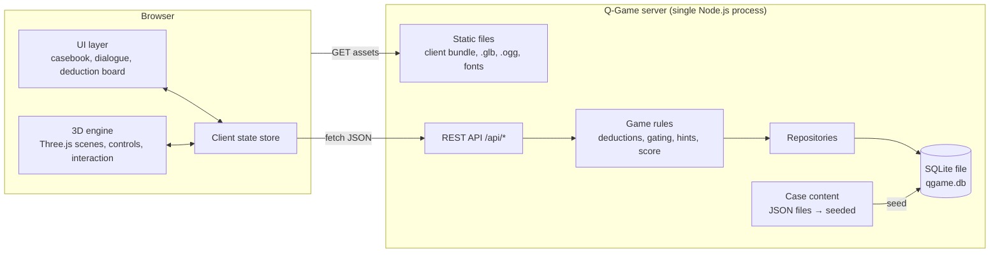
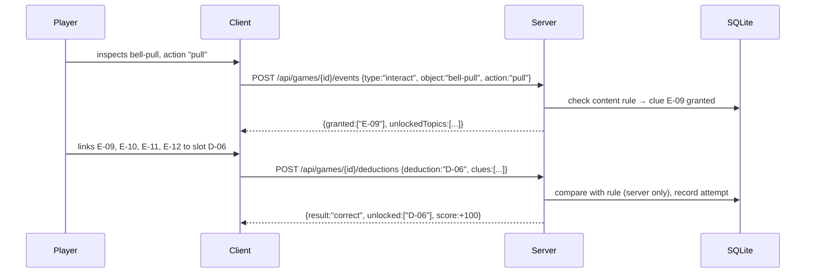

# System overview

One Node.js process serves everything. The browser downloads the client and
assets from it and talks to its JSON API. Game rules that decide the case
(deduction validation, scoring, chapter gating) run on the server.

## Components

| Component | Responsibility | Does not |
|---|---|---|
| 3D engine (client) | Render scenes, move the player, detect interactions, play audio | Decide if a deduction is correct |
| UI layer (client) | Casebook, dialogue, board, menus, HUD | Hold the solution |
| Client state store | Current scene, player position, collected clue ids, UI state; mirrors server progress | Persist anything itself (beyond a session cache) |
| Static server | Serve hashed client bundle and assets with long cache headers | Call external hosts |
| REST API | Profiles, saves, events (clue found, dialogue choice), deduction attempts, hints, score | Render or know about 3D |
| Game rules | Validate actions against content and progress; unlock deductions, chapters, topics | Read the filesystem directly |
| Repositories | All SQL; parameterised queries | Contain game rules |
| Case content | Scenes, objects, clues, dialogue, deductions, hints as versioned JSON | Execute code |

## Flow: finding a clue and making a deduction

## Why server-side rules

- The solution is not in the client bundle, so it cannot be read in DevTools.
- One source of truth for progress, so saves are reliable.
- The rules engine is plain TypeScript with no 3D, so it is fast to unit-test.
