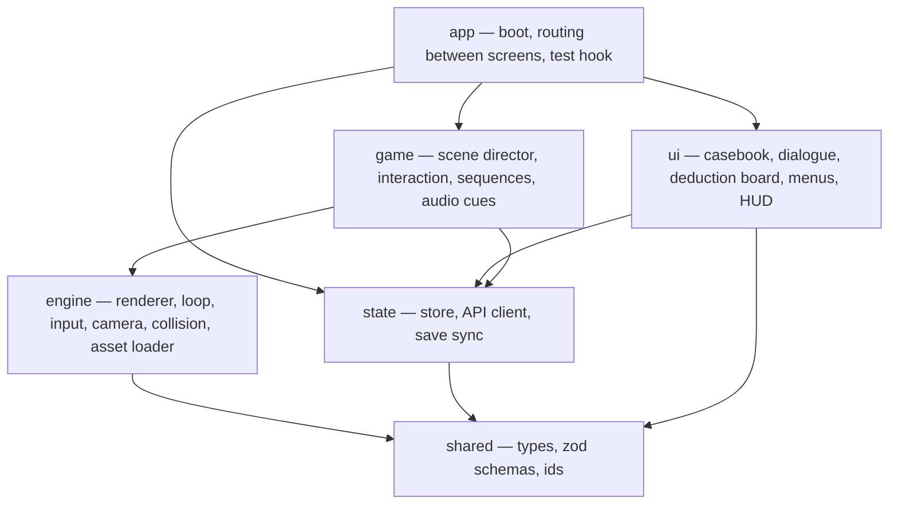

# Client

## Layers

Dependencies only point downward. `engine` knows nothing about Sherlock
Holmes; `game` knows the case only through content data.

## Engine

- **Loop**: `requestAnimationFrame`; fixed-step update (60 Hz) for movement and
  sequences, variable render.
- **Renderer**: Three.js WebGL 2; sRGB output; baked lightmaps + a few dynamic
  lights (fire, lamp, lantern); shadows only where needed.
- **Input**: keyboard/mouse with remappable bindings; pointer lock for
  mouse-look; click-to-move mode.
- **Camera / player**: first-person capsule; collision against a simplified
  collision mesh per room (three-mesh-bvh).
- **Asset loader**: GLTFLoader with Meshopt/Draco and KTX2; per-scene manifests;
  progress shown on the loading screen; assets disposed on scene change.

## Game

- **Scene director**: loads a scene from content (`scenes/*.json`): model,
  spawn points, interactables, triggers, ambience.
- **Interaction**: raycast from the camera centre; objects tagged in the glTF
  (`userData.interactId`) map to content objects and their actions.
- **Inspect view**: renders the object in a separate close-up scene; rotate,
  zoom, choose an action.
- **Observation mode**: portrait close-up with hotspots for people.
- **Sequences**: data-driven timelines (cues at times or on conditions) for
  Roylott's visit and the vigil; the vigil checks the strike window locally
  and confirms with the server.
- **Audio**: positional sounds for whistle, hiss, clang; ambience per scene.

## UI

- DOM overlay above the canvas; keyboard navigable; ARIA labels.
- Casebook tabs; dialogue panel with choices and a log; deduction board with
  drag-and-drop **and** keyboard selection.
- Settings applied immediately and saved to the server.

## State

- Store holds: profile, game id, chapter, scene, player transform, collected
  clue ids, unlocked topics and deductions, settings.
- Every meaningful action is sent to the server as an **event**; the server's
  response is the source of truth and is merged into the store.
- Position autosave every 60 s and on scene change.

## Test hook

In test mode (`?test=1`, only when the server allows it) the app exposes
`window.__qgame` with read-only state, `teleport(spawnId)`, `interact(objectId,
action)`, `skipAnimations()`, and `fps()`. The client reads test-mode permission
from `/api/client-config`, which is controlled by the server-side
`QGAME_TEST_MODE=1` toggle. See [07-testing-strategy.md](07-testing-strategy.md).
