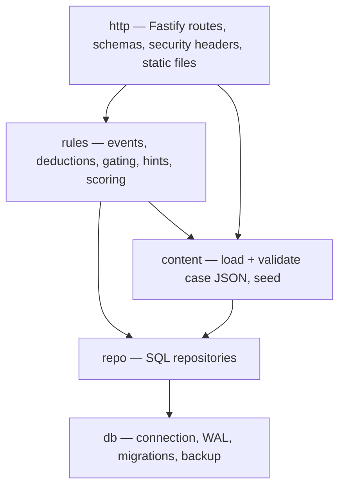

# Server and API

## Modules

`rules` is pure TypeScript: given content, current progress and an action, it
returns a result and the changes to persist. No I/O inside it.

## API (JSON over HTTP)

| Method and path | Purpose |
|---|---|
| `GET /api/health` | Liveness and content version |
| `GET /api/profiles` · `POST /api/profiles` | List or create profiles |
| `GET /api/profiles/:id/saves` | Save slots |
| `POST /api/games` | New game in a slot `{profileId, slot, caseId}` |
| `GET /api/games/:id` | Full progress (chapter, scene, position, clues, topics, deductions, score) |
| `PUT /api/games/:id/position` | Autosave position `{sceneId, transform}` |
| `POST /api/games/:id/events` | Player action `{type, objectId?, action?, dialogueChoiceId?, evidenceId?}` → clues granted, topics/events unlocked |
| `GET /api/games/:id/dialogue/:nodeId` | Next dialogue node with the choices available now |
| `POST /api/games/:id/deductions` | Attempt `{deductionId, clueIds[]}` → correct / hint id |
| `POST /api/games/:id/refutations` | Refute a red herring with clue ids |
| `POST /api/games/:id/puzzles/will` | Will figures → correct / which row is wrong |
| `POST /api/games/:id/vigil` | Vigil result `{struckAtMs, moved}` → success / retry |
| `POST /api/games/:id/explanation` | Final five answers with cited deductions |
| `POST /api/games/:id/hints` | Next hint for current objective |
| `GET /api/content/:caseId/public` | Public content only: scene list, object names, clue texts already granted — never rules or answers |
| `GET /api/settings/:profileId` · `PUT` | Settings |

## Rules the server enforces

- A clue is granted only if the content allows it for that object, action and
  current chapter.
- Dialogue choices are offered only when their conditions are met.
- A deduction is correct only if the submitted clues equal its required set
  (and the player owns those clues).
- Chapters unlock only when their required deductions exist.
- Score is computed from recorded events; the client never sends a score.

## Cross-cutting

- Request/response schemas with Zod (shared with the client).
- Structured logs (JSON) with request id; no personal data beyond profile name.
- Security headers: CSP `default-src 'self'`; no inline scripts; static assets
  with immutable cache headers.
- Optional `QGAME_ACCESS_KEY` env var: if set, every request needs it (cookie
  set once from a login page).
- Errors use a single shape `{code, message, hint}`; codes are stable.
