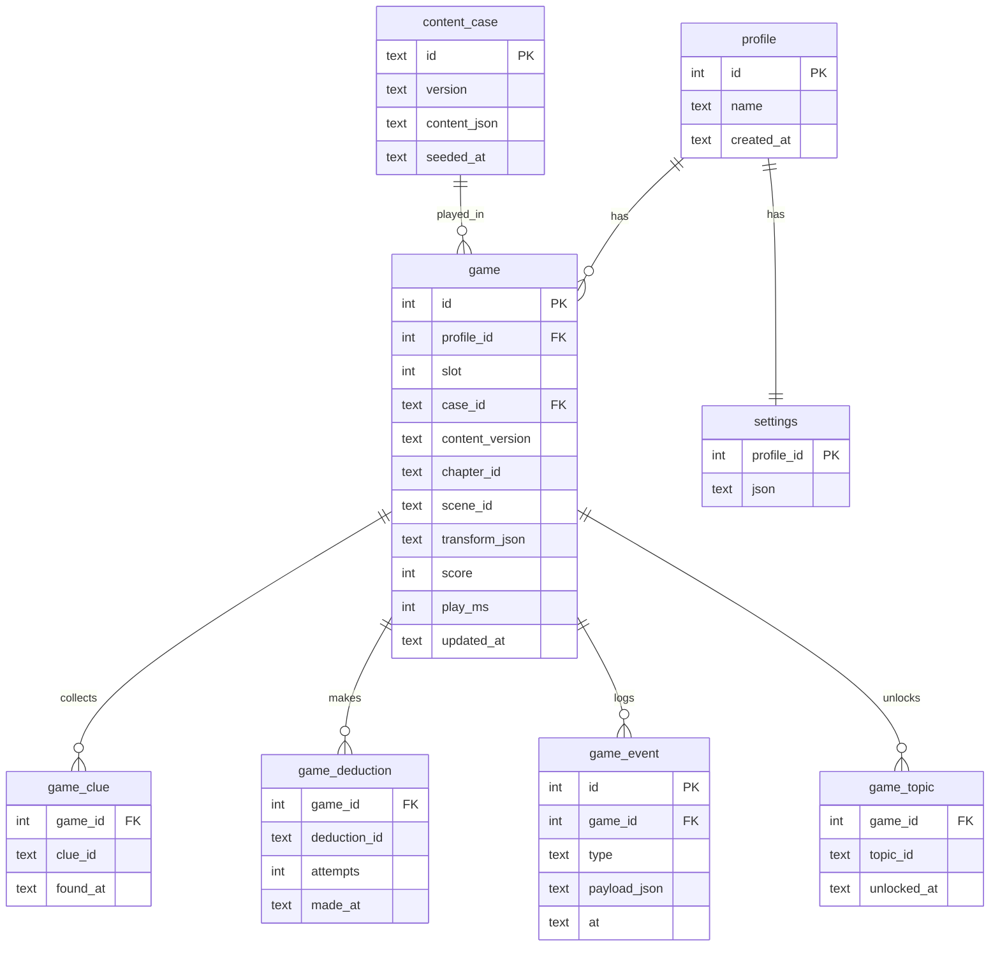

# Data model

Two kinds of data: **case content** (authored, versioned in git, read-only at
runtime) and **player data** (written at runtime, in SQLite).

## Case content (files in `content/cases/speckled-band/`)

| File | Holds |
|---|---|
| `case.json` | id, title, version, chapters (id, title, required deductions to enter, scenes) |
| `scenes/<id>.json` | model file, spawn points, interactables (object id, glTF node name, actions), triggers, ambience |
| `clues.json` | E-xx: title, text, category (evidence/testimony), granted by (object+action / dialogue / event) |
| `dialogue/<character>.json` | nodes, lines (speaker, text, origin), choices with conditions and effects |
| `deductions.json` | D-xx: title, text, required clues/deductions, effects (unlock chapter, topic) — **server only** |
| `red-herrings.json` | R-xx: claim, refuting clues — **server only** |
| `hints.json` | per objective, three levels — server only |
| `explanation.json` | five questions, answers, required citations — server only |
| `sequences/<id>.json` | timed cues for Roylott's visit and the vigil |

All files are validated by Zod schemas in `shared/` at seed time and in CI.
The **fair-play validator** walks the content graph and fails if any clue
needed for D-12 is unobtainable before chapter 5 (FR-61).

## SQLite schema (player data + seeded content)

- `game_event` is append-only: every action is logged, so score and progress
  can be recomputed and play-throughs replayed in tests.
- Unique keys: `(profile_id, slot)` on `game`; `(game_id, clue_id)` etc.
- Migrations in `server/migrations/NNN_name.sql`, applied in order at startup.
- `content_version` on each game lets the server detect saves from older content.

## Shared ids

Ids are strings matching the requirement ids (`E-09`, `D-06`, `L-06`), so
tests, content, requirements and the feature list all use the same names.
