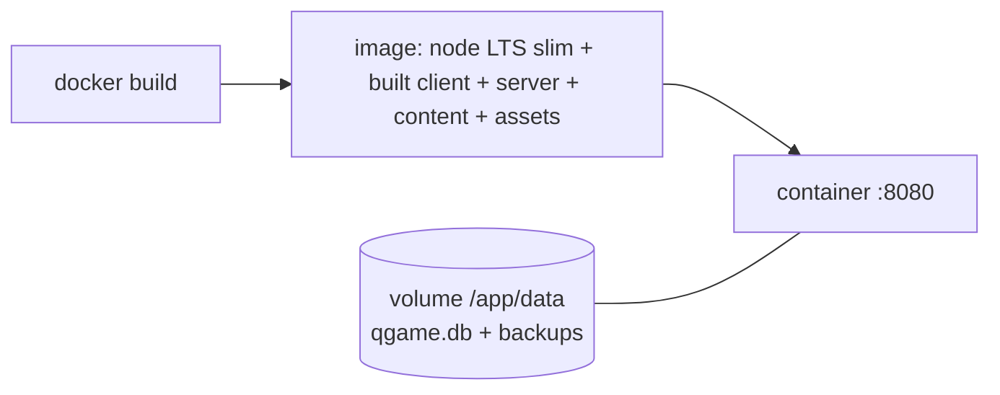

# Deployment

## Local (development and single machine)

```bash
npm ci                 # install from lock file
npm run seed           # validate content, run migrations, seed SQLite (data/qgame.db)
npm run dev            # Vite dev server + API with reload
npm run build && npm start   # production: server serves the built client on :8080
```

## Docker



- Multi-stage build: install → test → build → small runtime image.
- Only `/app/data` is writable; everything else read-only.
- Runs as a non-root user; no outbound network needed.

## Configuration (environment variables)

| Variable | Default | Purpose |
|---|---|---|
| `PORT` | 8080 | HTTP port |
| `QGAME_DB_PATH` | `data/qgame.db` | SQLite file |
| `QGAME_ACCESS_KEY` | (unset) | Optional shared key when exposed beyond a LAN |
| `QGAME_TEST_MODE` | 0 | Allow `?test=1` and the test hook |
| `QGAME_BACKUP_DIR` | `data/backups` | Daily SQLite backup target (online backup API) |

## Operations

- Health: `GET /api/health`.
- Backups: daily copy via SQLite's online backup; keep 7.
- Upgrades: replace the image; migrations run at startup; content version
  recorded on each save.
- HTTPS: terminate at a reverse proxy (Caddy, nginx) if served beyond a LAN.
