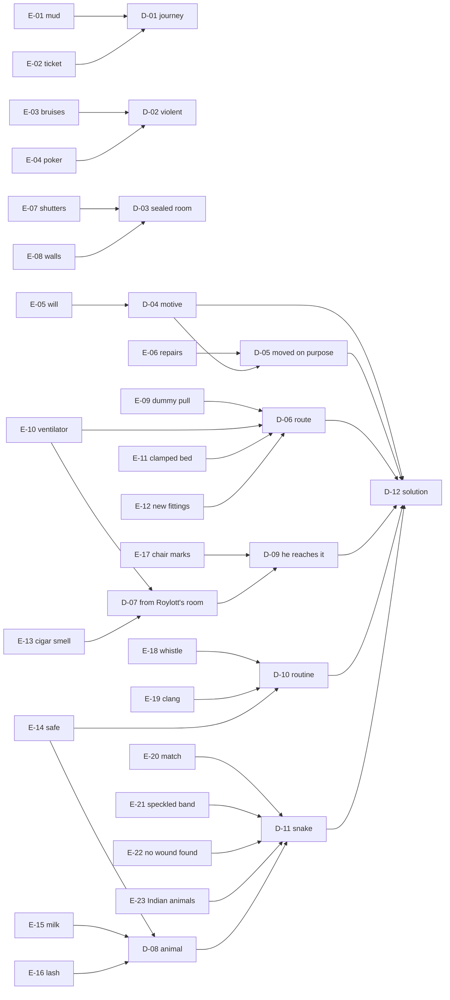

# Deduction chain

The player builds deductions on the deduction board by linking clues
(`E-…`, [03-locations-and-clues.md](03-locations-and-clues.md)). A deduction
unlocks only when its required clues are linked correctly. The server checks
the links; the solution never ships in the client bundle.

## Deductions

| ID | Deduction | Requires | Unlocks |
|---|---|---|---|
| D-01 | Helen came by dog-cart and train this morning | E-01, E-02 | Holmes's opening (score bonus) |
| D-02 | Roylott is violent and controls Helen | E-03, E-04 | Urgency: investigate today |
| D-03 | Nobody could enter Julia's room | E-07, E-08 | Rules out R-01 |
| D-04 | Roylott loses money if either daughter marries | E-05 | Motive |
| D-05 | Helen was moved into Julia's room on purpose | E-06, D-04 | The danger is the room, not the house |
| D-06 | The cord and ventilator are a route to the bed | E-09, E-10, E-11, E-12 | Method (route) |
| D-07 | Something passes from Roylott's room | E-10, E-13 | Points at L-05 |
| D-08 | Roylott keeps and handles an animal | E-14, E-15, E-16 | Means |
| D-09 | Roylott reaches the ventilator himself | E-17, D-07 | Agent |
| D-10 | The whistle calls it back; the clang shuts it away | E-18, E-19, E-14 | Routine |
| D-11 | A venomous snake: the "speckled band" | E-20, E-21, E-22, E-23, D-08 | Weapon identified |
| D-12 | **Roylott killed Julia with a trained snake and will kill Helen** | D-04, D-05, D-06, D-09, D-10, D-11 | The vigil (chapter 5) |

## Wrong links

Linking clues that do not support a deduction gives a Watson-style hint that
points back to the evidence ("Holmes, could anyone have come through those
shutters?"). It costs no score the first time and a small penalty after.
Red herrings (R-01…R-06) can be proposed as deductions and must be refuted
with the clues listed for them.

## Final explanation (chapter 6)

The player answers five questions; each answer must cite at least one
deduction. All five correct = case solved.

| Question | Correct answer | Supported by |
|---|---|---|
| Who killed Julia Stoner? | Dr Grimesby Roylott | D-09, D-12 |
| How? | A trained swamp adder, sent through the ventilator and down the dummy bell-pull | D-06, D-10, D-11 |
| Why? | To keep the mother's money; Julia's marriage would cost him £250 a year | D-04 |
| Why did no one find the cause? | Two tiny punctures and a poison ordinary tests miss | D-11 (E-22) |
| Why was Helen next? | Her engagement; the "repairs" moved her into the room | D-05 |
