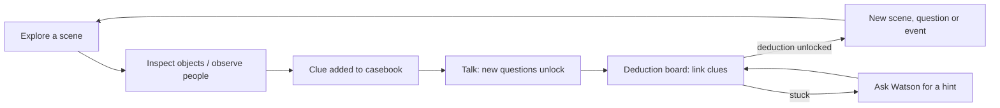

# Gameplay

## Core loop

## Chapters

| # | Chapter | Scene | Player does | Ends when |
|---|---|---|---|---|
| 1 | The client | L-01 | Observe Helen (E-01…E-03), hear her story (testimony clues), make D-01 | Helen leaves |
| 2 | The visitor | L-01 | Roylott bursts in; dialogue choices; poker event (E-04); D-02 | Roylott leaves |
| 3 | The will | L-02 | Read the will; fill in the money table (E-05); D-04 | D-04 made |
| 4 | Stoke Moran | L-03…L-07 | Explore outside and the three bedrooms; collect E-06…E-17, E-23; ask Helen on site; D-03, D-05…D-11 | D-12 made |
| 5 | The vigil | L-08 → L-06 | Signal from Helen's lamp; cross the lawn (baboon, cheetah); sit in the dark; react to light, smell, hiss; strike the cord at the right moment | Roylott's cry |
| 6 | The explanation | L-05 → L-01 | Enter Roylott's room (the band on his head); give the final explanation | All five answers correct |

## Mechanics

| Mechanic | Description |
|---|---|
| Movement | First-person: WASD + mouse look; alternative click-to-move on highlighted floor points |
| Inspect | Aim at an object → outline → press E/click → close-up view that can be rotated; actions per object (pull, tap, open, smell, move) |
| Observe a person | Close-up portrait mode with hotspots (sleeve, glove, wrist) |
| Casebook | Tabs: Evidence, Testimony, People, Places, Timeline, Deductions |
| Conversation | Branching dialogue; new topics unlock from clues; some answers only after showing evidence |
| Deduction board | Drag clues onto a deduction slot; the server validates; correct → animation and new deduction card |
| Will puzzle | Fill a small table: income then and now, share per marriage, what remains |
| Vigil | Real-time sequence in darkness: stay still and quiet (moving makes noise and fails), watch for the lantern glow, smell, hiss; strike the cord within a time window; retry from the start of the vigil on failure |
| Final explanation | Five questions, each answered by choosing an answer and citing deductions |
| Hints | Three levels from Watson: nudge → where to look → which clues to link |

## Scoring

| Item | Points |
|---|---|
| Each deduction | +100 |
| Holmes's opening (D-01) before Helen explains | +150 |
| Red herring refuted with evidence | +50 |
| Wrong link after the first | −10 |
| Hint level 1 / 2 / 3 | −0 / −25 / −75 |
| Vigil first attempt | +200 |
| Final explanation first attempt | +300 |

Rank at the end: Scotland Yard, Promising, Watson, Holmes.

## Fail and retry

The only fail states are the vigil (retry) and wrong final answers (retry
with a Watson nudge). The player can never lose the case permanently.
